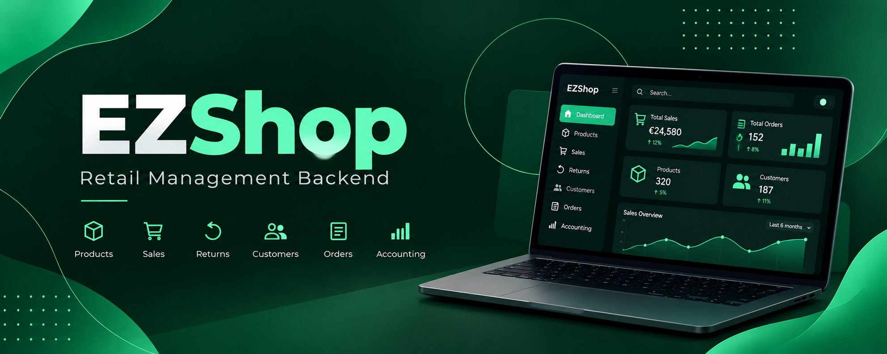

# EZShop — Retail Management Backend

EZShop is a RESTful backend application developed as a five-member university team project for the *Software Engineering I* course (2025-2026) at Politecnico di Torino.

The application provides backend services for managing the core operations of a retail store, including products, inventory, sales, returns, customers, orders, and accounting.

The project focuses on software engineering practices such as requirements analysis, layered architecture, API development, automated testing, and collaborative development.

## Features

- **User Management & Authentication:** User accounts, authentication, and role-based authorization.
- **Product & Inventory Management:** Product registration, updates, searching, stock quantities, and inventory organization.
- **Sales Management:** Creation and management of sales, sale lines, payment processing, and sale lifecycle operations.
- **Returns Management:** Processing product returns and reimbursements.
- **Customer Management:** Customer records and loyalty-related functionality.
- **Order Management:** Creating, managing, and tracking product orders.
- **Accounting:** Recording financial transactions and retrieving accounting information.

## Tech Stack

| Category | Technologies |
|---|---|
| Language | Python |
| Web Framework | FastAPI |
| Database | SQLite |
| ORM & Database Access | SQLAlchemy, aiosqlite |
| Data Validation | Pydantic |
| Authentication | JWT (PyJWT) |
| API Documentation | OpenAPI / Swagger UI |
| Testing | pytest, pytest-asyncio, pytest-cov, HTTPX |
| API Testing | Postman |
| Version Control | Git |

## Architecture

The application follows a layered backend architecture designed to separate responsibilities and support maintainability and testing.

- **Routes:** Define REST API endpoints and handle HTTP requests.
- **Controllers:** Coordinate application operations and business logic.
- **Repositories:** Handle data persistence and database interactions.
- **DAO / DTO Models:** Represent database entities and API data structures.
- **Services & Middleware:** Provide shared functionality, including authentication and data mapping.

The project is organized into the following main directories:

```text
EZShop/
├── app/
│   ├── config/
│   ├── controllers/
│   ├── database/
│   ├── middleware/
│   ├── models/
│   ├── repositories/
│   ├── routes/
│   └── services/
├── doc/
├── postman/
├── tests/
├── init_db.py
├── main.py
├── requirements.txt
└── README.md
```

## Getting Started

### Prerequisites

- Python 3.10 or later
- pip

### 1. Clone the repository

```bash
git clone https://github.com/letiziapontarolo/ezshop.git
cd ezshop
```

### 2. Create a virtual environment

```bash
python -m venv .venv
```

Activate the environment:

**Windows (PowerShell):**

```powershell
.\.venv\Scripts\Activate.ps1
```

**Linux / macOS:**

```bash
source .venv/bin/activate
```

### 3. Install dependencies

```bash
pip install -r requirements.txt
```

### 4. Configure authentication

The application requires a JWT signing secret, provided through the `EZSHOP_SECRET_KEY` environment variable.

**Windows (PowerShell):**

```powershell
$env:EZSHOP_SECRET_KEY = "replace-with-a-secure-random-secret"
```

**Linux / macOS:**

```bash
export EZSHOP_SECRET_KEY="replace-with-a-secure-random-secret"
```

Use a unique, securely generated secret for your local environment. Do not commit real secrets to version control.

### 5. Initialize the database

```bash
python init_db.py
```

### 6. Start the application

```bash
uvicorn main:app --reload
```

By default, the application is available at:

- **API:** http://127.0.0.1:8000
- **Swagger UI:** http://127.0.0.1:8000/docs
- **OpenAPI schema:** http://127.0.0.1:8000/openapi.json

## API Documentation

EZShop exposes REST endpoints under the `/api/v1` prefix.

The application includes endpoints for authentication, users, products, sales, returns, customers, orders, and accounting.

Interactive API documentation is available through FastAPI's built-in Swagger UI at `/docs`.

The repository also contains an OpenAPI specification and Postman resources for API exploration and testing.

## Testing

Automated tests were developed at different levels to validate the application's functionality and interactions between components.

The test suite includes:

- **Unit tests:** Validate individual components and repository behavior.
- **Integration tests:** Verify interactions between application layers.
- **API and end-to-end tests:** Validate REST endpoints and application workflows.

Testing approaches documented in the project include black-box, white-box, and gray-box techniques.

Run the test suite with:

```bash
pytest tests/
```

Generate a coverage report with:

```bash
pytest --cov=app tests/
```

**Documented result:** The team's recorded test run achieved **98% statement coverage**. Coverage screenshots and detailed test documentation are available in `doc/TestReport__2_.md`.

This figure refers to the documented project test run and may differ when tests are executed in another environment.

## Project Documentation

The `doc/` directory contains project materials produced during the Software Engineering I course, including:

- Requirements and functional specifications
- Estimation and planning documents
- Architecture and design diagrams
- OpenAPI specification
- Test reports and coverage evidence

## My Contributions

As part of the five-member development team, I primarily contributed to the **Sales Management module**, working across multiple layers of the backend architecture.

My contributions included:

- **Backend development:** Implemented sales-related API routes, controllers, repositories, DAO/DTO models, and data mapping logic.
- **Business logic:** Developed and refined operations for managing sales and sale lines, including adding and removing products, closing sales, and deleting sales.
- **Bug fixing:** Resolved issues related to sale closure dates, sale-line handling, and empty sales.
- **Software testing:** Developed and maintained unit, integration, API, and end-to-end tests for sales functionality.
- **Integration and API validation:** Contributed to application integration and maintained Postman API test collections.

These contributions are reflected in the project's original Git commit history.

*This is an academic project developed for educational purposes.*